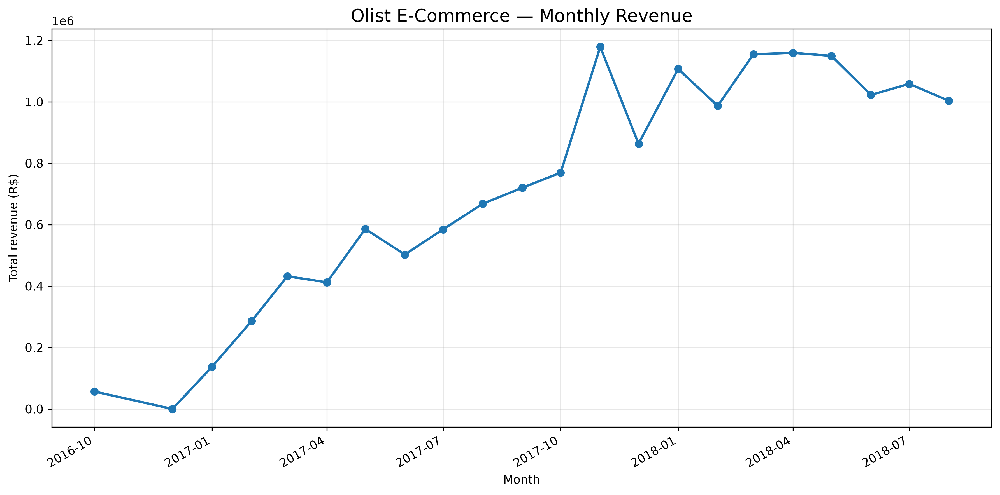
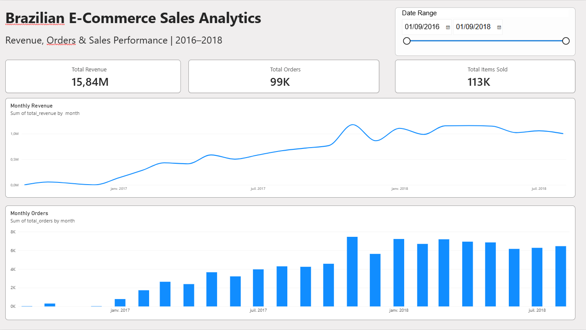

# E-Commerce Sales Analytics

An end-to-end data analytics project using the Brazilian E-Commerce Public Dataset by Olist.

## Project Overview

This project explores e-commerce sales, customer behavior, product categories, payment methods, delivery performance, and regional revenue. The objective is to transform raw transactional data into meaningful business insights using Python, SQL, and Power BI.

## Tools and Technologies

- **Python** — Data exploration and analysis
- **Pandas** — Data manipulation and preparation
- **PostgreSQL** — SQL queries and business analysis
- **Matplotlib** — Data visualization
- **Power BI** — Interactive dashboard and reporting

## Monthly Revenue Analysis

The monthly revenue analysis covers October 2016 through August 2018 and helps identify sales trends over time.



## Power BI Dashboard

The interactive dashboard provides an overview of revenue, order volume, and items sold, with a date-range slicer to explore performance over time.



## Key Project Areas

- Sales and monthly revenue trends
- Order volume and items sold
- Customer purchasing behavior
- Product category performance
- Payment method analysis
- Delivery performance
- Regional sales analysis

## Project Structure

ecommerce-sales-analytics/
├── dashboard/
├── data/
│   ├── raw/          # Original datasets (not uploaded)
│   └── processed/    # Processed data (not uploaded)
├── notebooks/
├── reports/
│   └── figures/
├── sql/
├── src/
├── .gitignore
├── requirements.txt
└── README.md

## Data Source

The project uses the [Brazilian E-Commerce Public Dataset by Olist on Kaggle](https://www.kaggle.com/datasets/olistbr/brazilian-ecommerce).

The dataset contains information about orders, customers, products, sellers, payments, reviews, and delivery dates.

**Note:** The original dataset files are not included in this repository. Download them from Kaggle and place the CSV files in `data/raw/`.

## Current Status

- [x] Project structure created
- [x] Python data exploration
- [x] Data quality investigation
- [x] SQL business analysis
- [x] Initial monthly revenue dashboard in Power BI
- [ ] Final business insights and recommendations
- [ ] Final documentation and portfolio polish

## How to Run

1. Clone this repository.
2. Create a Python virtual environment.
3. Install the dependencies:

   ```bash
   pip install -r requirements.txt
   ```

4. Download the dataset from Kaggle and place its CSV files in `data/raw/`.
5. Open the notebooks in `notebooks/` and run the analysis.

## Author

**Walid Bouremel**

Data Analytics | Python | SQL | Power BI
